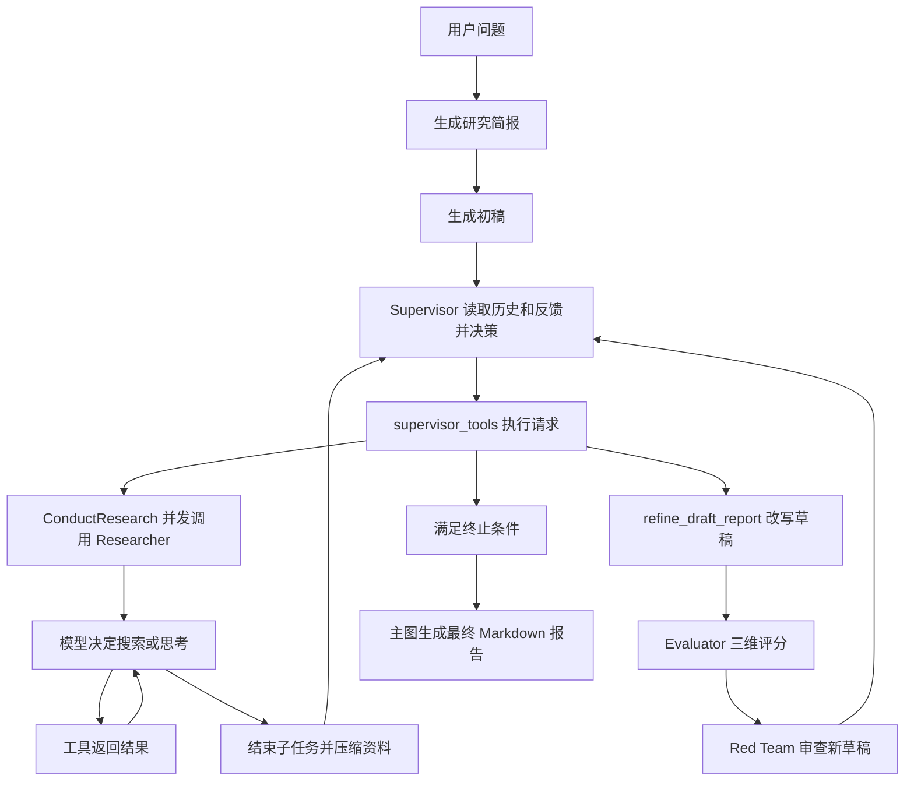

---
tags:
  - 面试
  - CloudResearch
  - LangGraph
  - DeepResearch
source_resume: 'C:/Users/皇甫柄/Desktop/timeline/job/resume-v2.pdf'
source_code: 'D:/ObsidianBase/源码/project-Deep_Research'
reviewed: 2026-10-10
---

# CloudResearch 简历逐句源码注解与面试问答

以用户提供的 [resume-v2.pdf](C:/Users/皇甫柄/Desktop/timeline/job/resume-v2.pdf) 第 2 页为准，将项目简介和三条核心工作拆成 18 个可追问的表述单元。每个单元包括含义、代码依据、回答示例和实现边界。关联笔记：[[Deep Research]]、[[DeepResearch Supervisor：工作流与状态流转]]。

源码支持这条主要链路：研究简报与初稿 → Supervisor 分配研究 → Researcher 检索并压缩 → Writer 修订 → Evaluator 评分 → Red Team 批评 → Supervisor 继续决策 → 最终报告。重点要讲清状态如何传递、反馈如何影响动作，以及“提示词要求”和“程序强制”之间的区别。

这里核对的是本地 `project-Deep_Research` 实现。它能证明机制怎样工作，不能单独证明生产接入情况、个人贡献归属或简历中的批量实验数字。后文的改进方案均明确写成建议，不视为已经完成的工作；不混入其他简历版本中的 13 项 G-Eval 或通义 DeepResearch 改造经历。

## 简历原文

**CloudResearch｜云售前多智能体自进化深度调研系统**

> 项目简介：IAH 面向海外销售汇聚多个专业 Agent，需要一套自研 Deep Research 能力完成复杂云技术调研与方案论证，并解决通用方案在云产品知识、架构约束与事实引用上的可靠性问题。为此构建 CloudResearch，自动完成联网调研并生成带引用源的 Markdown 研究报告，综合质量分达 8.84/10，引用 34+ 独立信源。

> 基于 LangGraph StateGraph 构建 4 层嵌套工作流，通过 Supervisor 统筹 Research 子任务与 Tool 工具链，结合 Role-based 多模型路由实现多智能体协同调研。

> 借鉴 Diffusion Model 思想设计降噪研究循环，Supervisor 通过 think_tool 策略反思实现 ReAct 风格推理决策，支持最多 15 轮迭代与 3 路并行子 Agent 检索，基于研究完整性自适应终止。

> 实现 LLM-as-Judge 三维质量评估（Comprehensiveness/Accuracy/Coherence，0–10 分），设计 quality_history 评估轨迹追踪与三维分数回传，均分低于阈值自动驱动修复形成自进化闭环；构建 Red Team Agent 对抗性审查，通过动态上下文注入实现自我纠正，红队审查通过率 90%+。

## 项目全流程

图中的评分与 Writer 调用发生在 `supervisor_tools` 节点内部。研究、改写由 Supervisor 的工具请求触发，不保证每轮都完整执行一遍上述步骤。

## 01 云售前场景与可靠性问题

**原文：**“IAH 面向海外销售汇聚多个专业 Agent，需要一套自研 Deep Research 能力完成复杂云技术调研与方案论证，并解决通用方案在云产品知识、架构约束与事实引用上的可靠性问题。”

**怎么理解：**场景需要把零散的产品信息组织成有证据的方案。以“某业务是否适合迁移到某云”为例，需要考虑功能是否具备、地域和版本限制、架构依赖以及证据是否足以支撑建议。这是解释业务需求的示例，不是已核验的项目案例。

**源码依据：**[主图入口][main]接收用户消息，生成研究简报，再执行研究和报告生成；[研究工具链][search]提供外部检索能力。当前通用提示词主要处理研究完整性、相关性与结构，未见云产品约束规则库、云领域专项 verifier 或 IAH 服务接入代码。领域可靠性是目标，不能仅凭通用工作流就断言已经全部解决。

**Q1 为什么普通 RAG 不够？**

答法：“复杂方案的问题通常不能一次展开完整。研究过程中会发现新的限制条件，需要继续提出问题、检索并修订结论。因此我把调研做成有状态的循环，让已有结果和反馈决定下一步。RAG 仍然是底层获取资料的环节。”

**Q2 你们怎么保证云产品知识准确？**

答法：“这份实现主要通过外部检索、保留来源和反馈修订提高可追溯性。严格的产品能力核验还需要把具体主张对齐到官方文档、地域、版本和时间条件。当前通用 Judge 没有逐条执行这种校验，不能把它的分数等同于云产品事实正确率。”

面试如需举真实业务案例，应补充你实际做过的任务、错误类型和修复前后报告，不能把示例直接说成线上成果。

## 02 联网调研与带引用的 Markdown 报告

**原文：**“为此构建 CloudResearch，自动完成联网调研并生成带引用源的 Markdown 研究报告。”

**源码依据：**[tavily_search][search]顺序执行检索、URL 去重、网页摘要和格式化；[format_search_output][format]保留标题、URL 和摘要；[compress_research][compress]压缩子任务上下文；[最终报告节点][final]将简报、草稿和 notes 传给 Writer；[最终报告提示词][citations]要求 Markdown 和来源列表。

实际信息路径是：`网页 → 带 URL 的摘要 → Researcher 压缩结果 → ToolMessage → notes → 最终报告`。URL 主要随文本流转，尚不是“每条结论绑定证据片段”的结构化证据数据库。

**Q3 引用是怎么从搜索一路保留到报告的？**

答法：“工具输出保留标题、URL 和摘要，Researcher 的压缩提示词要求保留来源，Supervisor 收集压缩结果，最终 Writer 按提示词生成引用与来源列表。这样能保留检索出处，但引用是否真正支持相邻论断，还需要独立核验。”

**Q4 网页太长或摘要失败怎么处理？**

答法：“网页原文先截断到配置的字符上限，再让摘要模型生成 summary 和 key_excerpts；摘要异常时回退到原文前 1000 个字符。Researcher 结束时还有一次任务级压缩。这里的截断单位是字符，不是 token；回退能继续流程，但可能漏掉关键证据。”

边界：URL 去重在一次工具处理的结果集合内进行，没有看到跨全部 Researcher 的全局去重库。`get_notes_from_tool_calls` 提取所有 ToolMessage，因此 notes 也可能包含思考回显和评分反馈，不完全是外部证据。

## 03 综合质量分 8.84

**原文：**“综合质量分达 8.84/10。”

**源码依据：**[均分计算][score]采用三维分数算术平均：

`平均分 = (comprehensiveness_score + accuracy_score + coherence_score) / 3`

这可以解释评分机制，不能还原 8.84 的实验来源。本地搜索到的 8.84 出现在简历及其历史稿件，没有找到对应的批量评分表。Notebook 保存的一次运行有四次评分，分别为 `(6,6,8)`、`(6,6,8)`、`(6,7,8)`、`(6,7,8)`；这只是另一条示例轨迹，不足以否定或证明简历数字。

**Q5 8.84 是怎么算的，是最终报告平均分吗？**

必须先确认：多少个问题、哪个 Judge、哪个提示词、评分对象是最终稿还是各轮草稿，以及先按报告平均还是把全部修订轮次混在一起平均。当前节点评估的是修订后的草稿，主图最终 Writer 输出之后没有再次评分。

答法模板：“在【N 个固定问题】上，用【模型及评分版本】评估【最终报告或明确的草稿版本】，按三维等权平均，再对任务取平均，得到 8.84。”方括号必须用真实记录补齐。

**Q6 为什么结果能精确到两位小数？**

三个维度在当前 schema 中是整数。一份报告的一次三维均分以 `1/3` 为步长，不能直接产生 8.84。这个数字若来自跨报告或跨多次评分的聚合，需要说明聚合层级；否则它与当前单次评分实现不对应。

## 04 引用 34 个以上独立信源

**原文：**“引用 34+ 独立信源。”

**源码依据：**[URL 去重][dedup]按完整 URL 字符串去重。它没有判断域名是否相同，也没有识别不同网站是否转引同一原始材料。

本地两个 `results` 示例按 `http(s)` 链接字符串粗计分别有 9、13 个不同 URL，对应 1、10 个不同 hostname。该统计没有做重定向或规范化，也不能代表其他运行；当前未找到能对应 34+ 的指定报告和计数记录。

**Q7 “独立信源”怎么定义？同一官网 34 页算 34 个吗？**

答法：“当前实现直接支持的是不同 URL 的资料条目计数。若这些链接来自同一官网，更准确的表述是‘引用 34+ 个资料页面’。要称为独立信源，还需明确按发布主体或原始证据来源去重，不能把 URL 数和来源独立性混为一谈。”

**Q8 引用多就意味着质量高吗？**

答法：“引用数量只反映资料规模。更关键的是核心结论的证据覆盖率、引用支持关系、来源权威性和时效性。增加引用也可能只是重复转载，因此需要把数量指标和事实质量分开。”

## 05 StateGraph 与四层嵌套

**原文：**“基于 LangGraph StateGraph 构建 4 层嵌套工作流。”

**源码依据：**[主图][main]注册 Supervisor 子图；[Supervisor 图][supergraph]内部执行研究委派；[Researcher 图][researchgraph]包含 `llm_call → tool_node → llm_call` 循环和压缩出口；第四层是搜索、摘要和格式化等 Python 工具函数。

准确理解是四个职责层级：主流程、研究协调、子任务研究、工具执行。主运行链上有三类 StateGraph，Tool 不是第四个独立 StateGraph。`draft_agent.py` 的 `__main__` 还提供一个独立演示图，但不是主运行链上的第四层。

**Q9 LangGraph 最重要的概念是什么？**

答法：“我最看重 State 以及它的更新语义。Node 读取当前状态、返回局部更新，Reducer 决定如何合并，Edge 或 Command 决定下一步。这个项目要多轮保留草稿、研究结果和反馈，状态设计决定了协作能否正确进行。”

**Q10 状态在父图和子图之间怎么传递？**

答法：“主图和 Supervisor 子图通过共有字段衔接，例如 research_brief、draft_report、notes。Supervisor 调 Researcher 时则显式构造子任务输入，等待返回后再把 compressed_research 包装为 ToolMessage，并汇总 raw_notes。Reducer 负责字段合并规则，不意味着所有子图自动共享全部状态。”

补充：`draft_report` 默认覆盖；`notes`、`raw_notes`、评分历史用列表追加；消息用 `add_messages` 合并。消息合并允许按消息 ID 更新已有项，不能简单概括为永远追加。[主状态][mainstate]、[Supervisor 状态][superstate]

## 06 Supervisor 与 Research 和 Tool 的分工

**原文：**“通过 Supervisor 统筹 Research 子任务与 Tool 工具链。”

**源码依据：**Supervisor 绑定 `ConductResearch`、`ResearchComplete`、`think_tool`、`refine_draft_report`。模型输出工具请求后，[supervisor_tools][dispatch]负责分派。每次 `researcher_agent.ainvoke` 只传入当前研究主题和该主题的初始消息；Researcher 再使用自己的检索和思考工具。[Researcher 工具绑定][researchtools]

**Q11 为什么主 Agent 不自己完成全部搜索？**

答法：“Supervisor 保留总体任务和研究进度，Researcher 在独立上下文里处理单一主题并返回压缩结果。这样便于同时研究互不依赖的方向，也能减少主上下文里的网页细节。代价是摘要可能损失证据，以及不同任务可能重复搜索。”

**Q12 子 Agent 能看到其他子 Agent 的结果吗？怎么避免重复？**

答法：“这份实现没有给 Researcher 共享全部历史，它主要依赖 Supervisor 提供完整、独立的研究任务。避免重叠主要靠任务拆分和主 Agent 已有的结果历史，没有全局语义去重机制。”

容易漏掉的细节：Supervisor 能在 Python 层访问 State，并不表示模型看到所有字段。模型实际输入由 `messages` 显式组装；当前调用没有每轮把最新 `draft_report` 全文重新塞进去。[模型输入构造][superinput]

## 07 Role based 多模型路由

**原文：**“结合 Role-based 多模型路由实现多智能体协同调研。”

**源码依据：**[get_chat_model][modelrouter]按角色查找配置中的 `backend` 和 `handle`，构造客户端。角色包括 supervisor、researcher_main、researcher_summarizer、researcher_compressor、writer、draft、evaluator、red_team。[角色配置][roleconfig]中存在角色到不同模型名的映射。

它是按角色配置的模型选择，通常在模块初始化时完成。不是根据每个用户问题的难度在线预测最优模型，也不是多个底层模型联合训练。多个角色可以使用同一个模型。

**Q13 怎么决定哪个角色使用更强模型？**

答法：“设计上可以把要求高的审查或决策交给更强模型，把摘要等较固定任务交给成本较低的模型；实际选择需要按角色做效果、延迟和成本对比。当前源码能证明角色可独立配置，不能证明已经做过完整的最优分配实验。”

**Q14 换一个模型是不是改名称就行？**

答法：“配置层可以统一模型名、地址和超时，但仍需验证接口兼容性、工具调用、结构化输出、上下文长度及输出上限。尤其 Supervisor 依赖 bind_tools，Evaluator 依赖结构化结果。”

当前 `_build_kwargs` 支持 OpenAI 兼容后端；PDF 版没有声称显式 `model_provider` 适配，也没有声称全链路结构化输出，面试时无需把旧 bullet 的这两项扩展回来。

## 08 借鉴扩散思想的降噪研究循环

**原文：**“借鉴 Diffusion Model 思想设计降噪研究循环。”

**源码依据：**[降噪研究提示词][denoise]要求提出缺口问题、ConductResearch 获取增量信息、refine_draft_report 修订草稿；[改写函数][refine]使用研究简报、findings 与旧草稿生成新草稿。这与 TTD-DR 的检索驱动报告修订思路一致。

这里的“噪声”是信息遗漏、不准确和论证不足；“去噪”是借助外部证据改善报告。没有扩散模型训练、噪声调度或反向扩散采样器。

**Q15 你到底用了什么 Diffusion Model？**

答法：“借鉴的是 TTD-DR 中将报告迭代类比为去噪的思路。模型先产生粗稿，再检索证据、修订并继续研究。执行层仍然是 LLM 调用和工作流，并没有训练一个扩散网络。”

**Q16 和普通自我反思有什么区别？你完整复现论文了吗？**

答法：“区别在于把新的外部检索证据用于修订，不仅让模型重复评价自己的文字。我的这份实现借鉴报告迭代，并加入评分和红队反馈；原论文组件级自进化还包含多个候选分别改进后合并，这部分不能说已经完整复现。”

当前数据流还有两点边界：初稿曾进入 Supervisor 历史，但后续新稿只覆盖 `draft_report`，回传消息主要包含评分和理由；同一轮同时请求研究与改写时，新研究结果还在局部 `tool_messages` 中，改写的 findings 读取的是节点进入时的历史。因此不能保证“每次改写都立即使用同轮新证据”。

## 09 think_tool 与 ReAct

**原文：**“Supervisor 通过 think_tool 策略反思实现 ReAct 风格推理决策。”

**源码依据：**[think_tool][think]接收 `reflection`，返回 `Reflection recorded: ...`。反思内容由请求该工具的模型生成；工具本身不再调用推理模型。Supervisor 按工具名称执行请求并把观察追加到历史；Researcher 也有模型与工具交替循环。

**Q17 think_tool 内部到底做了什么？为什么不是空操作？**

答法：“它把当前证据、缺口和下一步计划显式记录为一次工具交互，让这些内容进入后续消息历史。函数本身基本是回显，因此价值在于过程组织和可观察性；能否提升效果需要去掉该工具的消融实验。”

**Q18 有 think_tool 就一定是 ReAct 吗？**

答法：“关键是模型基于观察选择动作，工具执行后返回新观察，再影响后续动作。项目中 bind_tools、tool_calls 和 ToolMessage 构成这种循环。think_tool 是其中一个反思工具，不是 ReAct 的唯一条件。”

边界：提示词要求研究前后反思，但程序没有强制每次都调用。若同一个回复中同时包含 think 和 ConductResearch，研究请求参数在工具执行前已经生成，不能说本轮研究参数是执行 think_tool 后才重新规划的。

## 10 最多 15 轮迭代

**原文：**“支持最多 15 轮迭代。”

**源码依据：**[轮次配置][limits]设置 `max_researcher_iterations = 15`。每次 Supervisor 决策后，`research_iterations` 加一；工具节点在执行动作之前判断是否 `>= 15`。[计数更新][superupdate]、[终止检查][stop]

**Q19 一轮是什么？15 是模型调用数还是搜索次数？**

答法：“计数的是 Supervisor 的决策轮次。一轮可以产生多个工具请求，一个 Researcher 内部也能搜索多次，所以 15 不能理解成全系统只有 15 次模型调用或 15 次搜索。”

**Q20 第 15 轮还会执行工具吗？**

答法：“按这份代码，从零开始时第 15 次 Supervisor 调用会把计数更新为 15，随后工具节点先命中终止条件，因此不会执行这一轮提出的请求。准确口径是最多 15 次 Supervisor 决策，而不是完整执行 15 轮研究。”

Researcher 虽然定义了 `tool_call_iterations` 字段，但目前未见用它递增和终止的逻辑。子图主要依据是否还有工具请求结束；框架递归限制是另一层保护，不是这里的业务轮次预算。

## 11 三路并行子 Agent 检索

**原文：**“与 3 路并行子 Agent 检索。”

**源码依据：**[并发委派][parallel]为本轮所有 ConductResearch 请求构造协程，通过 `asyncio.gather(*coros)` 等待结果。`max_concurrent_researchers = 3` 被写入提示词；没有看到对任务列表截断、队列调度或 `Semaphore(3)`。

**Q21 3 路并行怎么实现？如果模型输出 5 个任务呢？**

答法：“并发执行由 asyncio.gather 完成，3 路是提示词中的任务分配预算。这份代码会对所有请求创建协程，所以模型若输出 5 个有效研究请求，仍可能执行 5 路。要保证资源硬上限，需要再加信号量或分批队列。”

**Q22 并发失败和速度收益怎么处理？**

答法：“并发适合相互独立、主要等待 API 的研究任务，但总耗时仍受慢任务和限流影响。当前 gather 没有按任务收集异常，一路抛错会进入外层异常分支并结束 Supervisor 子图；主图仍可能用已有结果生成报告。更完善的做法是为每路设置超时、错误状态与重试，并保留成功结果。”

不能把它说成 GPU 模型并行，也不能未经实验声称三路就快三倍。子 Agent 里的工具调用和多网页处理仍有顺序执行部分。

## 12 基于研究完整性的自适应终止

**原文：**“基于研究完整性自适应终止。”

**源码依据：**提示词指导 Supervisor 根据研究成果完整性选择 `ResearchComplete`；[工具节点][stop]还会在无工具请求、轮次耗尽时结束，异常分支也会结束。

**Q23 完整性怎么量化？有明确覆盖率阈值吗？**

答法：“当前完整性主要由模型根据研究简报、历史结果和反馈判断，并通过 ResearchComplete 显式表达。没有把计划拆成可验证清单后计算覆盖率，所以它是模型驱动的停止策略。”

**Q24 怎么区分完成、预算用尽和失败？**

答法：“当前代码通过不同条件进入 END，但没有把统一的 stop_reason 输出给用户。工程上应分别记录 completed、budget_exhausted、no_tool_calls、tool_error，并在预算耗尽时保留未解决问题，避免把所有退出都算任务成功。”

自适应终止也不保证最终一定高于质量阈值；代码没有在 END 前强制检查最新均分或未解决批评。

## 13 三维 LLM as Judge 评分

**原文：**“实现 LLM-as-Judge 三维质量评估（Comprehensiveness/Accuracy/Coherence，0–10 分）。”

**源码依据：**[evaluate_draft_quality][evaluator]把研究简报与当前新草稿交给 evaluator，使用 [EvaluationResult][evalschema] 解析三个整数分数和 reason。[评分提示词][evalprompt]解释每个维度。

| 维度 | 设计含义 | 当前实际约束 |
|---|---|---|
| Comprehensiveness | 是否覆盖研究简报的主要内容 | 提示词检查遗漏 |
| Accuracy | 名称指准确性，schema 提到 factual grounding | 提示词更偏是否符合简报、有无偏题；未提供独立原始证据集 |
| Coherence | 逻辑连贯与可读性 | 提示词检查结构和专业表达 |

**Q25 Judge 怎么核验事实？**

答法：“当前 Judge 直接接收简报和草稿，能发现明显错误或不一致，但没有独立检索，也没有逐项将主张与原文对齐。所以它是质量代理信号，尤其 Accuracy 不能等同于事实准确率。更严格的版本应提供证据片段并单独核验关键主张。”

**Q26 结构化输出能保证打分正确且在 0–10 吗？**

答法：“结构化输出有助于解析字段和类型，不能保证判断正确。当前 Field 描述了 0–10，但没有 ge=0、le=10 的范围校验。生产化还需要数值范围验证、解析异常处理和人类评分校准。”

此外，Evaluator 是 `supervisor_tools` 内部调用的函数，不是单独注册的 LangGraph 节点。Writer 改写后先评估，再进入 Red Team。

## 14 quality_history 与三维分数回传

**原文：**“设计 quality_history 评估轨迹追踪与三维分数回传。”

**源码依据：**[QualityMetric][qualityschema]只有 `score`、`feedback`、`iteration` 三个字段。[SupervisorState][superstate]使用 `operator.add` 累积列表。[实际写入][history]保存均分、原因和 Supervisor 轮次；三维分项分数单独打印到日志。

这里需要精确区分：评估器确实返回三维结构化结果，但传回 Supervisor 的 ToolMessage 和写入 quality_history 的内容是均分与理由，没有三个独立数值字段。

**Q27 quality_history 能画出三维曲线吗？**

答法：“当前 state 可以直接恢复综合分随修订变化的轨迹，三维曲线需要另外解析日志。若希望状态本身支持三维分析，应在 QualityMetric 中保存三个分项分数，并增加草稿版本和评价版本。”

**Q28 这个轨迹能跨运行持久化、随时恢复吗？**

答法：“当前它首先是一次 Supervisor 子图执行内的状态。主图 schema 没有暴露 quality_history，compile 也没有配置 checkpointer；Notebook 主要保存最终 Markdown。不能仅凭一个 state 字段就声称实现了跨运行的持久追踪和恢复。”

同一工具节点若处理多个 refine 请求，`updates['quality_history']` 会在循环中反复赋值，节点提交时只保留最后一条。字段的追加 Reducer 不会自动恢复被局部覆盖的记录。

## 15 低分修复与自进化闭环

**原文：**“均分低于阈值自动驱动修复形成自进化闭环。”

**源码依据：**[阈值配置][limits]是 6.0；[评分后更新][history]在均分低于阈值时置 `needs_quality_repair=True`；Supervisor 下次调用前追加修复提醒，随后将标志重置为 False。[反馈输入][superinput]

**Q29 阈值是多少？低于阈值后是程序直接重写吗？**

答法：“实际判断阈值是 6.0。低分后程序设置修复标志，在下一轮提示 Supervisor 继续完善，由模型决定补检索还是改写。它自动触发的是修复提醒，并不是程序强制循环到达标为止。”

源码中的提醒文字写的是“低于 7/10”，与实际判断的 6.0 不一致。面试报阈值应依据判断逻辑，并将该不一致作为待修正项。

**Q30 自进化会更新模型参数吗？能保证分数一直提升吗？**

答法：“这里改进的是当前任务的报告和决策上下文，模型参数不更新。评价后修改可能改善，也可能退化；当前没有保留最佳版本和分数下降回滚机制，不能保证单调提升。”

要验证模块有效性，应在固定任务与预算上对比去掉评分、去掉红队和完整系统，使用独立评审观察质量、证据正确性、延迟和费用变化。此处是实验设计建议，不是现成实验结果。

## 16 Red Team 对抗性审查

**原文：**“构建 Red Team Agent 对抗性审查。”

**源码依据：**[red_team_node][redteam]调用独立角色模型，输入研究简报和最新草稿。[红队提示词][redprompt]要求找出覆盖缺失、偏题、逻辑冲突等问题，输出最多三条可操作意见；基本合格时回复 PASS。

**Q31 已经有 Evaluator 了，为什么还要红队？**

答法：“Evaluator 给出整体维度分数与解释，便于追踪质量；红队把注意力集中在少量关键漏洞及可执行改进上。前者概括质量水位，后者给出修订目标。两者可能存在重叠，实际增益需要消融验证。”

**Q32 这里是 GAN 或对抗训练吗？怎么防止红队无限挑错？**

答法：“它是角色分工上的对抗审查，没有生成器与判别器的梯度博弈。提示词要求只提重大问题，单次最多三条；程序在累计三次有效批评后跳过后续审查，以控制开销。”

注意两个“3”不同：单次最多三条意见是提示词要求；`MAX_CRITIC=3` 限制的是累计记录有效批评的次数。PASS 不增加该计数，因此不能说总共最多调用红队三次。

## 17 动态上下文注入与自我纠正

**原文：**“通过动态上下文注入实现自我纠正。”

**源码依据：**红队将反馈写入 `active_critiques`，同时追加一条 SystemMessage 到历史。Supervisor 每轮筛选 `addressed=False` 的 Critique，并在局部 `messages` 中再加入指导信息。[红队更新][redteam]、[Supervisor 注入][superinput]、[Critique schema][critiqueschema]

**Q33 动态注入究竟注入到哪里，为什么不只放历史？**

答法：“在下一次调用 Supervisor 前，把尚未处理的批评从结构化状态中取出来，拼成本轮 SystemMessage，让当前决策明确关注这些问题。历史保存上下文，动态消息强调当前待解决事项。这里的模型输入要由代码组装，模型不会自动读整个 State。”

**Q34 怎么判断旧批评已经被解决？**

答法：“当前 schema 有 addressed 字段，但代码创建后始终为 False，没有实现更新成 True 的闭环。红队返回 PASS 也不会清除旧批评，因此旧意见可能持续注入。完整实现应给批评分配 ID，针对新稿逐条验证，再标记解决或保留。”

当前通过反馈影响下一步决策的路径确实存在，但不能把它描述为已经逐条验证修复、自动关闭所有问题。旧批评还会同时出现在历史和动态消息中，存在重复占用上下文的问题。

## 18 红队通过率 90 以上

**原文：**“红队审查通过率 90%+。”

**源码依据：**[红队函数][redteam]有多条路径返回空更新 `{}`：包含 PASS、回复少于 20 字符、达到批评次数上限、草稿为空或过短。它没有输出统一的 pass/fail/skipped 结构，也未见批量通过率统计器。

**Q35 90% 的分母是什么？怎么避免把跳过审查算通过？**

必须说明按任务还是按调用计数，是初稿还是最终稿，通过由哪个 Judge 决定，重试如何处理，跳过和异常如何计入。不能把“函数返回空字典”当作通过，因为多个跳过分支也返回空字典。

答法模板：“在【N 份符合审查条件的报告】中，用【固定红队模型及提示词】完成审查，【K 份】明确通过；跳过与异常单列，所以通过率为 K/N。”当前本地材料没有补齐 N、K 和判定日志。

**Q36 判断 PASS 的逻辑可靠吗？90% 能证明没有事实错误吗？**

答法：“目前是子串判断，像‘NOT PASS’也可能被误当成通过；短回复也会被当成无问题。这一实现需要改成结构化 verdict 并区分 pass、fail、skipped、error。即便判定完善，红队通过也只表示该审查器在给定信息下没发现重大问题，不能等同于事实完全正确。”

## 最值得提前准备的源码追问

| 表述 | 面试中的精确口径 | 当前需要补齐的部分 |
|---|---|---|
| 四层嵌套 | 四个职责层级，主链有三类 StateGraph | 不把工具层说成第四个独立图 |
| 三路并行 | gather 并发，提示词预算为三路 | 代码级限流及单任务异常隔离 |
| 15 轮 | Supervisor 决策次数上限 | 不等同于搜索次数，第 15 次请求不执行 |
| 三维回传 | Judge 产生三维分数，日志记录分项 | State 和 ToolMessage 目前只保留均分与理由 |
| 自动修复 | 低分自动追加修复提醒 | 没有强制达标门禁和最佳稿回滚 |
| 动态纠错 | 未解决批评进入下一轮模型输入 | addressed 没有更新闭环 |
| 自进化 | 当前任务输出的反馈迭代 | 没有在线更新模型参数 |
| 8.84 | 指定评测集上的明确聚合指标 | 样本、Judge、报告版本、评分明细 |
| 34+ | 明确是链接、域名还是独立原始来源 | 对应报告与去重规则 |
| 90%+ | 有明确分母和审查结果的通过率 | 排除跳过，修正 PASS 解析，保存审查明细 |

## 一分钟项目讲述

下面这段聚焦当前代码能解释的机制；生产接入和个人改动范围按真实经历补充。

> CloudResearch 面向需要多轮资料检索与方案论证的深度研究任务。我用 LangGraph 组织了主流程、Supervisor 协调和 Researcher 子任务，通过状态保存草稿、研究结果及反馈。Supervisor 负责决定研究主题和下一步动作，Researcher 在独立上下文中检索并返回压缩资料，再由 Writer 修订报告。
>
> 报告改写后会接受三维质量评估和红队审查，反馈进入下一轮 Supervisor 的模型输入，影响继续搜索还是修改报告。这个设计借鉴了 TTD-DR 的检索驱动修订思路，自进化发生在当前任务的报告层面。并发研究用于处理独立主题，决策轮次上限用于控制运行开销。
>
> 实现里最关键的是把状态更新、模型输入和工具执行顺序分清：数据进入 State 后，还需要显式放进模型输入才能影响决策；提示词预算也需要程序约束才能成为可靠的资源上限。

## 面试前准备的四份材料

1. **一条完整研究轨迹**：用户问题、研究简报、子任务、引用资料、两版草稿、评分和红队意见，展示反馈具体改变了什么。
2. **一张状态流转图**：标明哪些字段覆盖、哪些追加，以及 Supervisor 实际发送给模型的内容。
3. **一份指标明细**：为 8.84、34+、90%+ 分别固定样本范围、计数单位和数据来源；没有记录的部分先明确边界。
4. **一份个人改动清单**：区分基础项目已有功能、你新增或修改的代码、你完成的实验和生产接入。不用“整个仓库都能运行”代替个人贡献说明。

## 源码索引

所有行号对应 2026-10-10 读取的本地文件。以下索引便于按问答跳转。

- [主图构建][main]；[最终报告生成][final]
- [主图状态定义][mainstate]；[Supervisor 状态定义][superstate]
- [Supervisor 图构建][supergraph]；[模型输入与动态注入][superinput]
- [计数和状态更新][superupdate]；[终止检查][stop]
- [工具请求分派][dispatch]；[并发 Researcher 调用][parallel]
- [评分计算][score]；[质量历史与低分标志][history]
- [Researcher 工具绑定][researchtools]；[Researcher 图][researchgraph]；[研究结果压缩][compress]
- [搜索工具入口][search]；[URL 去重][dedup]；[来源格式化][format]
- [think_tool][think]；[报告改写工具][refine]
- [角色模型选择][modelrouter]；[角色配置][roleconfig]
- [Evaluator 调用][evaluator]；[三维结果 schema][evalschema]；[质量记录 schema][qualityschema]
- [Red Team 节点][redteam]；[Critique schema][critiqueschema]
- [评分提示词][evalprompt]；[红队提示词][redprompt]；[降噪研究提示词][denoise]；[最终引用规则][citations]
- [运行 Notebook][notebook]；[报告示例 1][sample1]；[报告示例 2][sample2]
- [TTD-DR 原文](https://arxiv.org/html/2507.16075v1)；[LangGraph Graph API](https://docs.langchain.com/oss/python/langgraph/graph-api)

[main]: D:/ObsidianBase/源码/project-Deep_Research/deep_research/agent_builder.py:53
[final]: D:/ObsidianBase/源码/project-Deep_Research/deep_research/agent_builder.py:25
[mainstate]: D:/ObsidianBase/源码/project-Deep_Research/deep_research/states/draft.py:25
[superstate]: D:/ObsidianBase/源码/project-Deep_Research/deep_research/states/supervisor.py:23
[supergraph]: D:/ObsidianBase/源码/project-Deep_Research/deep_research/agents/supervisor.py:334
[superinput]: D:/ObsidianBase/源码/project-Deep_Research/deep_research/agents/supervisor.py:101
[superupdate]: D:/ObsidianBase/源码/project-Deep_Research/deep_research/agents/supervisor.py:134
[stop]: D:/ObsidianBase/源码/project-Deep_Research/deep_research/agents/supervisor.py:160
[dispatch]: D:/ObsidianBase/源码/project-Deep_Research/deep_research/agents/supervisor.py:195
[parallel]: D:/ObsidianBase/源码/project-Deep_Research/deep_research/agents/supervisor.py:230
[score]: D:/ObsidianBase/源码/project-Deep_Research/deep_research/agents/supervisor.py:277
[history]: D:/ObsidianBase/源码/project-Deep_Research/deep_research/agents/supervisor.py:290
[limits]: D:/ObsidianBase/源码/project-Deep_Research/deep_research/agents/supervisor.py:81
[researchtools]: D:/ObsidianBase/源码/project-Deep_Research/deep_research/agents/research_agent.py:28
[researchgraph]: D:/ObsidianBase/源码/project-Deep_Research/deep_research/agents/research_agent.py:124
[compress]: D:/ObsidianBase/源码/project-Deep_Research/deep_research/agents/research_agent.py:83
[search]: D:/ObsidianBase/源码/project-Deep_Research/deep_research/tools/tool.py:269
[dedup]: D:/ObsidianBase/源码/project-Deep_Research/deep_research/tools/tool.py:197
[format]: D:/ObsidianBase/源码/project-Deep_Research/deep_research/tools/tool.py:244
[think]: D:/ObsidianBase/源码/project-Deep_Research/deep_research/tools/tool.py:314
[refine]: D:/ObsidianBase/源码/project-Deep_Research/deep_research/tools/tool.py:341
[modelrouter]: D:/ObsidianBase/源码/project-Deep_Research/deep_research/llm.py:126
[roleconfig]: D:/ObsidianBase/源码/project-Deep_Research/config.yml:23
[evaluator]: D:/ObsidianBase/源码/project-Deep_Research/deep_research/agents/evaluator_agent.py:18
[evalschema]: D:/ObsidianBase/源码/project-Deep_Research/deep_research/states/eval_result.py:10
[qualityschema]: D:/ObsidianBase/源码/project-Deep_Research/deep_research/states/quality.py:9
[redteam]: D:/ObsidianBase/源码/project-Deep_Research/deep_research/agents/red_team_agent.py:26
[critiqueschema]: D:/ObsidianBase/源码/project-Deep_Research/deep_research/states/critique.py:10
[evalprompt]: D:/ObsidianBase/源码/project-Deep_Research/deep_research/prompts/draft_evaluator.py:6
[redprompt]: D:/ObsidianBase/源码/project-Deep_Research/deep_research/prompts/red_team.py:6
[denoise]: D:/ObsidianBase/源码/project-Deep_Research/deep_research/prompts/research_denoise.py:1
[citations]: D:/ObsidianBase/源码/project-Deep_Research/deep_research/prompts/final_report.py:89
[notebook]: D:/ObsidianBase/源码/project-Deep_Research/run.ipynb
[sample1]: D:/ObsidianBase/源码/project-Deep_Research/results/output_report_sample_1.md
[sample2]: D:/ObsidianBase/源码/project-Deep_Research/results/output_report_sample_2.md
