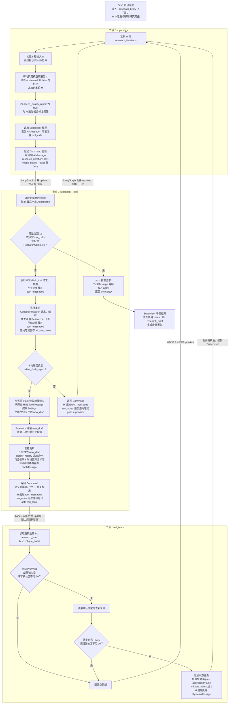
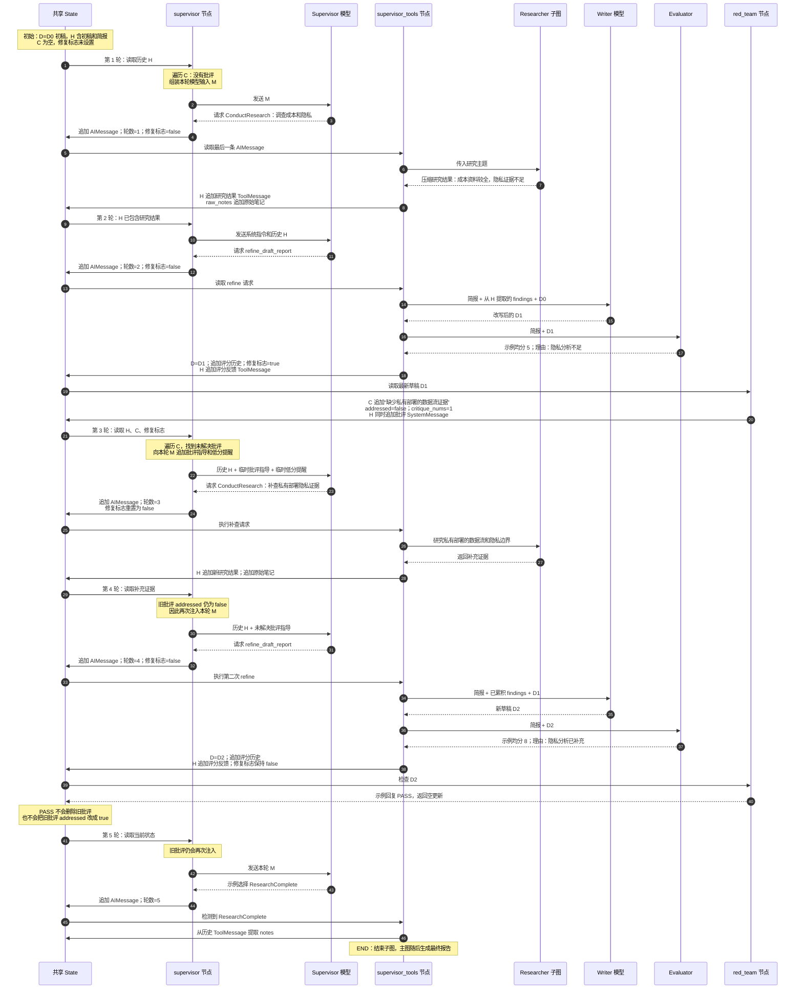

---
tags:
  - LangGraph
  - DeepResearch
  - Agent
---

# DeepResearch Supervisor：工作流与状态流转

关联笔记：[[Deep Research]]

本文按项目实际代码整理。第一张图展示完整流程与数据流；第二张图展示一个假设问题的运行过程，研究内容、分数和模型决策仅作示例。

## 变量约定

| 缩写 | 变量 | 含义 |
|---|---|---|
| H | `state["supervisor_messages"]` | 当前流程内维护的 Supervisor 消息历史 |
| D | `state["draft_report"]` | 当前草稿 |
| C | `state["active_critiques"]` | 累积的红队批评 |
| M | Supervisor 中的局部变量 `messages` | 本轮发送给模型的输入列表 |

State 是节点读写的数据容器；M 是从 State 中挑选信息后组装的模型输入。模型不会自动读取整个 State。

## 完整工作流与数据流

大框是真正的 LangGraph 节点，框内是节点内部的处理步骤。节点返回 update 后，由 LangGraph 合并进 State，再执行下一节点。



图中省略异常分支：工具执行 try 块中发生异常时，当前代码也会返回 END。

## 运行示例：研究大模型客服的成本与隐私

研究请求和改写请求分别放在不同轮次。下面的“写入 State”箭头表示节点返回更新后，由 LangGraph 完成合并，不是节点直接修改共享对象。



## 关键变量的读写路径

| 变量 | 谁写入 | 谁读取、什么时候读取 | 更新方式 |
|---|---|---|---|
| `supervisor_messages` | Supervisor 写决策；工具节点写结果；红队写批评 | Supervisor 每轮组装输入；工具节点取最后一条决策 | add_messages 合并，新消息通常追加 |
| `draft_report` | Draft 写初稿；工具节点写新草稿 | Writer、红队、最终报告节点；Evaluator 直接接收局部 new_draft | 覆盖旧稿 |
| `active_critiques` | 红队发现问题时 | Supervisor 每轮调用模型前遍历 | 追加 |
| `needs_quality_repair` | 工具节点评分低于 6 时置 true | Supervisor 下一轮调用前检查 | Supervisor 提醒后提交 false |
| `quality_history` | 工具节点评分后 | 当前 Supervisor 不直接向模型发送整份评分历史 | 追加；一轮多个 refine 时局部 updates 只保留最后一条 |
| `research_iterations` | Supervisor 决策后加一 | 工具节点检查是否达到 15 | 覆盖计数 |
| `critique_nums` | 红队记录有效批评时加一 | 红队检查是否达到 3 | 覆盖计数 |
| `findings` | 工具节点执行 refine 时生成 | Writer | 局部变量，不是这里的 State 字段 |
| `tool_messages` | 工具节点内部暂存结果 | 节点返回时合并到消息历史 | 返回前尚未写入 State |

## 关键细节：当前实现与设计意图的区别

### 1. 每轮什么时候遍历批评？

每次进入 supervisor，在调用模型之前执行：

```python
critiques = state.get("active_critiques", [])
unaddressed = [c for c in critiques if not c.addressed]
```

如果筛选结果非空，就把批评指导追加到本轮局部输入 M。这次追加本身不会更新历史 H。

### 2. 红队批评有两条路径进入模型

红队返回时，一方面往 C 追加 Critique，另一方面往 H 追加批评 SystemMessage。因此同一意见既在历史中出现，也会因 addressed=false 被下一轮再次注入。

### 3. addressed 没有闭环更新

当前代码创建批评时设置 addressed=false，但没有把它改成 true 的实现。即使新草稿已解决问题，或者红队回复 PASS，旧批评仍会继续被注入。PASS 只是让当前红队节点返回空更新，不会清空旧字段。

### 4. Refine 的正文和反馈走不同路径

```text
new_draft → state["draft_report"] → 红队、下一次 Writer、最终报告
评分和理由 → ToolMessage → supervisor_messages → 下一轮 Supervisor 模型
```

Supervisor 模型不会自动收到整份新草稿。红队意见也没有作为专门参数直接传给 refine；它先影响 Supervisor 决策，再可能通过补充研究等路径影响改写。

### 5. 同一轮的研究结果，不能立即被该轮 refine 从 State 读到

本轮研究结果先放在局部 tool_messages 中，节点返回后才合并进 H。但 refine 的 findings 从进入节点时的 H 提取。因此同一回复同时请求 ConductResearch 和 refine 时，后者读不到本轮刚完成但尚未提交的研究结果。

类似地，同一轮多个 refine 都从原始 state 读取 draft_report，不会自动以此前局部 new_draft 为输入；最终状态更新主要保留最后一次改写。

### 6. findings 并不只有研究资料

get_notes_from_tool_calls 实际提取全部 ToolMessage，没有按工具名筛选。因此 findings 和最终 notes 可能同时包含研究结果、think_tool 回显、评分反馈。

### 7. 低分阈值与提醒文字不一致

实际判断是平均分低于 6；Supervisor 的提醒文字却写“低于 7/10”。图按实际判断阈值 6 绘制。

## 对照源代码

- 状态定义：`deep_research/states/supervisor.py`
- 调度、工具执行与图构建：`deep_research/agents/supervisor.py`
- 红队节点：`deep_research/agents/red_team_agent.py`
- 批评字段：`deep_research/states/critique.py`
- 改写工具：`deep_research/tools/tool.py`

项目目录：`D:\workspace\video\01丁师兄大模型项目_基于自进化+对抗降噪的DeepResearch Agent项目实战\代码\project-Deep_Research`