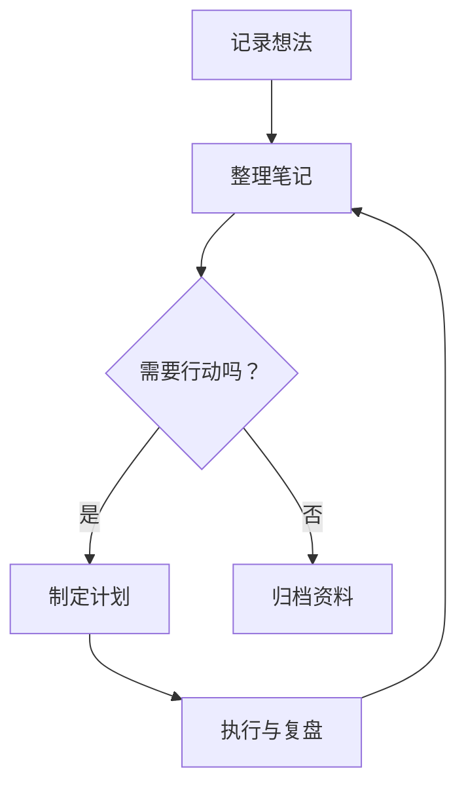

# Mermaid 流程图示例

Obsidian 内置 Mermaid 支持，无需安装额外插件。

## 查看流程图

- 在阅读视图中，下方代码块会显示为流程图。Windows 下按 `Ctrl + E` 可切换编辑和阅读视图。
- 使用实时预览时，把光标移到代码块之外即可查看图形。
- 如果仍然只看到代码，请在「设置 → 编辑器」中把默认编辑模式设为「实时预览」，或切换到阅读视图。



## 在其他笔记中使用

复制下面的完整代码，包括首尾的三个反引号，粘贴到笔记中。代码块语言必须写为 `mermaid`。

````markdown

````

`TD` 表示从上到下，`LR` 表示从左到右。修改方括号里的文字即可更改节点内容。

官方说明：[Obsidian 高级格式语法](https://obsidian.md/help/advanced-syntax)。
